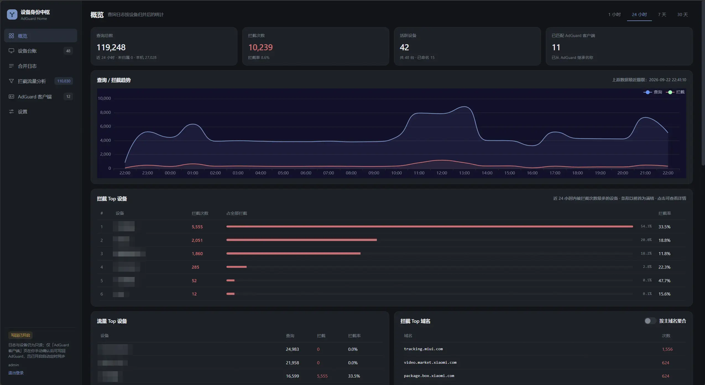
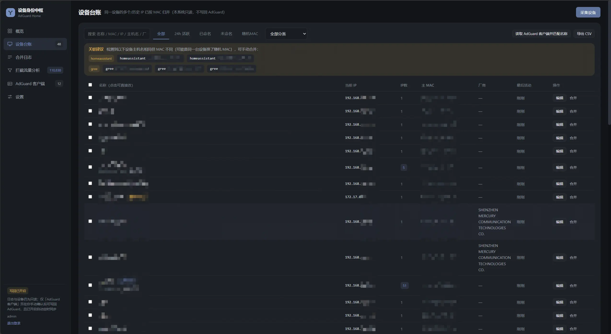
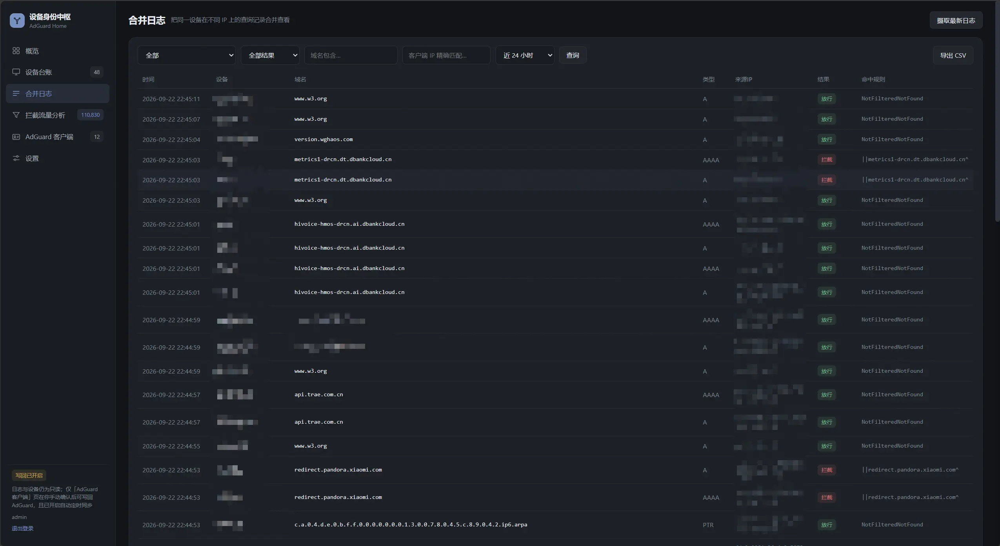
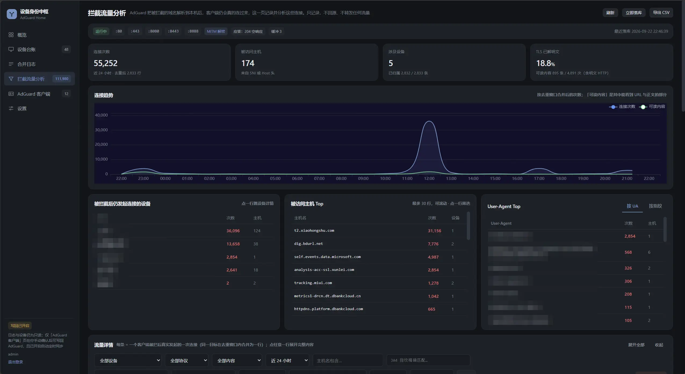
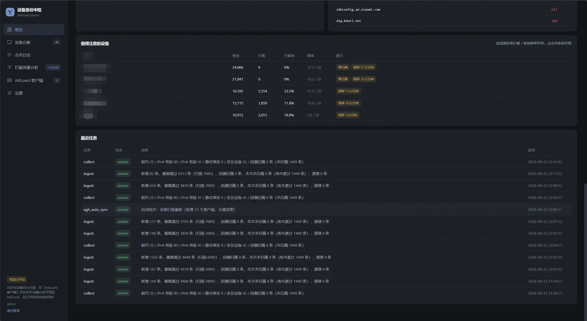

# AdGuard Home 设备身份中枢 · adh-device-hub

> 用 MAC 地址把 AdGuard Home 里散成一堆 IP 的查询日志按「设备」合并

[](https://nodejs.org/)
[](https://expressjs.com/)
[](https://github.com/WiseLibs/better-sqlite3)
[](https://vuejs.org/)
[](https://echarts.apache.org/)

---

## 目录

- [简介](#简介)
- [功能特性](#功能特性)
- [界面预览](#界面预览)
- [快速开始](#快速开始)
  - [开机常驻](#开机常驻)
- [使用](#使用)
- [拦截流量分析](#拦截流量分析)
- [工作原理](#工作原理)
- [安全](#安全)
- [备份](#备份)
- [已知限制](#已知限制)
- [常见问题](#常见问题)
- [开发](#开发)
- [附录](#附录)：REST API · 全部设置项与默认值 · 目录结构

---

## 简介

内网设备经常换 IP，AdGuard Home 的日志和统计因此无法和设备关联上。本工具以 **MAC 为关联**，把同一设备的多个和历史 IP 归并成一个「设备」，并把查询日志归档到本地 SQLite 后按设备归并。

- **可命名、可合并**：给设备起中文名，两台设备可以合并成一台。
- **设备合并**：可自动/手动合并同终端。
- **默认只读**：不修改路由器与 AdGuard 的任何配置。

### 只读范围

| 目标 | 允许的操作 |
|---|---|
| 路由器（SSH） | `cat /tmp/dhcp.leases`、`ip neigh`、`ip -6 neigh`、`uci show dhcp`、`cat /proc/net/arp` |
| AdGuard Home | `GET /control/querylog`、`GET /control/clients` |

> [!NOTE]
> 唯一的写入功能在「AdGuard 客户端」页，**默认关闭**。需要在设置里显式打开「允许写回 AdGuard」，且每次写入前先给差异预览。

---

## 功能特性

| 模块 | 说明 |
|---|---|
| **设备台账** | SSH 读 DHCP 租约与 IPv4/IPv6 邻居表，按 MAC 归并多个和历史 IP，维护 IP 归属时间线；标记随机 MAC |
| **命名与合并** | 中文名、分类、标签、备注、忽略；两台设备可合并；台账多选批量改，点设备名直接改名 |
| **合并日志** | 增量归档查询日志到本地 SQLite，按设备看查询数、拦截数、拦截率、Top 域名与趋势，可筛选导出 |
| **拦截流量分析** | 被拦域名解析到本机后客户端真的来连，本机就地记录是哪台设备、连了哪台主机、请求了什么。只记录，不转发 |
| **AdGuard 客户端** | 列出 AdGuard 客户端并映射回本系统设备，可新建、同步 ids、清理失效 id，支持定时自动同步 |
| **异常画像与导出** | 高流量零拦截、查询频率异常的设备；台账与日志 CSV、SQLite 快照导出 |

---

## 界面预览

<table>
  <tr>
    <td width="50%" align="center">
      <br>
      <sub><b>概览</b>：按设备归并后的查询 / 拦截统计与趋势</sub>
    </td>
    <td width="50%" align="center">
      <br>
      <sub><b>设备台账</b>：多个与历史 IP 按 MAC 归并，可命名、可合并</sub>
    </td>
  </tr>
  <tr>
    <td width="50%" align="center">
      <br>
      <sub><b>合并日志</b>：归属到设备的查询明细与拦截结果</sub>
    </td>
    <td width="50%" align="center">
      <br>
      <sub><b>拦截流量分析</b>：被拦后客户端真的来连本机时的记录</sub>
    </td>
  </tr>
  <tr>
    <td width="50%" align="center">
      <br>
      <sub><b>异常画像与定时任务</b>：异常设备、采集与摄取运行记录</sub>
    </td>
    <td width="50%"></td>
  </tr>
</table>

---

## 快速开始

**前置条件**

- Node.js ≥ 18.17
- 部署机能访问路由器（SSH）与 AdGuard Home（HTTP API）

```bash
npm install
npm start          # 默认 0.0.0.0:7788
```

访问 `http://<部署机IP>:7788`，首次打开引导创建管理员。数据在 `./data` 或 `DATA_DIR`，备份时一起带走。

**环境变量只有三个**，其余配置在页面里改：

| 变量 | 默认值 | 说明 |
|---|---|---|
| `PORT` | `7788` | 监听端口 |
| `HOST` | `0.0.0.0` | 监听地址 |
| `DATA_DIR` | `<项目目录>/data` | 数据目录 |

### 开机常驻

前台跑 `npm start` 时进程挂在 SSH 会话下，关掉 SSH 就被终止。用 systemd：

```bash
cd /opt/adh-device-hub
npm install --omit=dev      # 必须在本机装，better-sqlite3 是原生模块
sudo cp deploy/adh-device-hub.service /etc/systemd/system/   # 先改里面的 User、WorkingDirectory、node 路径
sudo systemctl daemon-reload
sudo systemctl enable --now adh-device-hub
```

只想临时试一下：

```bash
setsid nohup node src/server.js > adh-device-hub.log 2>&1 < /dev/null &
```

**启动失败通常是三种**

- 报 `Cannot find module` → 依赖问题。
- 报 `status=203/EXEC` → node 路径写错。
- 服务起来了但台账是空的 → `DATA_DIR` 指到了别处。

> [!NOTE]
> 环境不支持挂载命名空间时会报 `226/NAMESPACE`，去掉服务文件里的 `PrivateTmp=true`。

**监听 80/443 的权限**：拦截流量分析要用 80/443，非 root 运行需要

```bash
sudo setcap 'cap_net_bind_service=+ep' $(readlink -f $(which node))
```

> [!WARNING]
> 这条会作用于**所有** Node 进程。

---

## 使用

1. 引导页创建管理员账号。
2. 「设置 → 连接配置」填 SSH（路由器地址、root、密码或私钥）与 AdGuard Home（面板地址与账号），各点一次「测试」。
3. 「设备台账」点采集设备，自动发现并归并设备。点「读取 AdGuard 客户端并匹配名称」可以把 AdGuard 里已有的中文名继承过来。
4. 给设备起中文名。
5. 「合并日志」点摄取最新日志，之后定时任务持续增量摄取。
6. 可选：「设置 → 拦截流量分析」打开开关，并把 AdGuard 的拦截模式设为自定义 IP → 本机地址。

---

## 拦截流量分析

**特别注意：使用该功能可能会导致智能电视投屏失败或视频加载缓慢**

AdGuard 的拦截模式设为「自定义 IP → 本机地址」后，被拦域名会解析到这台机器，客户端往往会真的发连接过来（80 明文、443 TLS）。AdGuard 那边只留一条已拦截的日志，本功能就在本机等着这些连接并记录。

- **默认关闭**，关闭时不占端口。
- **不转发流量**：没有 upstream 配置，不会因为收到请求去连任何真实服务器；应答只有 204、直接关闭、提示页三种常量。

> [!IMPORTANT]
> 拦截模式必须用「自定义 IP」，并设置为你部署设备的ip地址。

**能看到什么**

| 协议 | 可分析 | 客户端信任根证书后 |
|---|---|---|
| 明文 HTTP | Host、方法、路径、query、UA、Cookie、正文 | — |
| TLS | SNI、ALPN、声明的最高 TLS 版本 | 完整 URL、Header、正文 |
| 其他端口 | 五元组与首包 hex，识别出协议后按上面对应处理 | 同上 |

**备注**

- 端口与协议不一一对应，443 上可能有明文，8080 上也可能有 TLS，每条连接先嗅探首包再分派解析器。
- TLS 默认只读 SNI 不解密；切成解密模式会用 `data/sink-ca/` 的自签 CA 动态签发证书，能拿到完整 URL 与正文，代价是要给目标设备装根证书，证书固定的 App 会握手失败。
- 被拦的 App 常以秒级频率重试，所以同一「客户端 + 端口 + 主机 + 方法 + 路径」在 60 秒内合并成一行累加次数，每秒最多新增 50 行，内存聚合后每 5 秒落库，记录默认保留 14 天。

---

## 工作原理

SSH 读租约与邻居表后按 MAC 把 IP 归组，每段 `(设备, IP)` 记下 first_seen 与 last_seen，形成归属时间线。摄入日志时按日志时间戳取该 IP 当时的持有者，所以 IP 被回收再分给别的设备，旧日志仍归原设备。采集后还会做一次回溯修正，把因 IP 尚未被观测到而没归属的日志补上，IPv6 临时地址尤其依赖这一步。

### 为什么不用 AdGuard 的 MAC 识别？

因为对 IPv6 无效：AGH 的识别来源里 `arp` 指操作系统的 IPv4 ARP 表，没有 IPv6 邻居发现，内置 DHCP 关闭时也没有这条来源；客户端走 IPv6 时，AGH 即使配了 MAC 也仍按原始 IPv6 地址记录。本系统把 AGH 只当日志来源，MAC 只在本系统内部给 IP 分组，AGH 侧不用改。

### 写回同步策略

打开写回后，以 AdGuard 自己的统计保留时长为窗口：窗口内还有查询的地址写进 ids，没有的就删掉，所以 ids 会收敛；`fe80::/10`、回环、组播不写；IPv6 按 RFC 5952 规范化后比对，否则会出现反复写同一个地址。

---

## 安全

**忘记密码**

```bash
npm run reset-password -- 新密码
```

> [!WARNING]
> 不要删 `data/device-hub.db` 来重置，会丢掉设备命名、IP 历史和已归档日志。

---

## 备份

备份 `data/` 目录：

- `device-hub.db`
- `secret.key`
- `oui.csv`
- 用过解密模式再加 `sink-ca/`

---

## 已知限制

| 限制 | 解决方案 |
|---|---|
| 被路由转发的其它网段认不出来 | 在设备详情里手工加 IP |
| 个别日志始终未归属 | 休眠设备在采集瞬间取不到 MAC，曾出现过的会自动回溯 |
| IPv6 隐私地址轮换快 | 把采集间隔调到 60–120s |
| 随机 MAC 导致设备分裂 | 用「合并」，或按主机名关联 |
| 日志只从开始采集时累积 | AdGuard 自身日志窗口有限，越早开始越好 |
| 收不到 UDP/QUIC | 不在范围内；多数客户端会回退 TCP，回退后即可记录 |

---

## 常见问题

- **一台设备被识别成两台？** 多半是随机 MAC 或换了网卡，用「合并」并过去。
- **日志比 AdGuard 少？** 本地归档从点采集时开始，把「抓取范围（天）」调大后重新采集。
- **在 AdGuard 里配了 MAC，日志里还是按 IP 显示？** AGH 的 MAC 识别依赖 IPv4 ARP 表，对 IPv6 客户端无效，AGH 侧改也没用。想让它自己的统计也按设备归并，用「AdGuard 客户端」页同步。
- **改了中文名，日志里还显示主机名？** 显示名是读取时实时取的，改完立即生效。
- **「合并日志」和「拦截流量分析」的区别？** 前者是 AdGuard 看到的 DNS 查询，后者是被拦之后客户端真的来连本机的请求。可以对照看「拦了 100 次，其中 32 次真的来连」。

---

## 开发

```bash
npm run dev            # node --watch
npm run check-ui       # 改完 public/ 后跑
```

---

## 附录

<details>
<summary><b>REST API</b></summary>
<br>
**认证与设置**

```
GET  /api/setup/status          是否已初始化
POST /api/setup                 创建管理员（仅首次）
POST /api/login | /api/logout
GET  /api/me

GET  /api/settings | PUT /api/settings
GET  /api/connections | POST | PUT /:id | DELETE /:id | POST /:id/test
GET  /api/status | /api/jobs
GET  /api/sysinfo               本机系统/硬件/温度信息
```

**采集**

```
POST /api/collect               立即采集
POST /api/ingest                立即采集日志（body: {days:N} 可回填）
POST /api/agh/import            读取 AdGuard 客户端并匹配名称
```

**AdGuard 客户端**

```
GET  /api/agh/clients           列出 AdGuard 客户端 + 映射到的本系统设备 + 同步状态
GET  /api/agh/clients/plan      单个变更预览：?name=&deviceId=[&includeUnknown=]
GET  /api/agh/clients/plan-batch 批量/全量变更预览：?names=a,b[&includeUnknown=]
POST /api/agh/clients           新建客户端，或同步 ids        ← 需 allow_agh_write
POST /api/agh/clients/sync      批量/全量同步 ids            ← 需 allow_agh_write
POST /api/agh/clients/delete    删除客户端                   ← 需 allow_agh_write
GET  /api/agh/stale             扫描可清理的 id
POST /api/agh/stale/clean       清理失效 id                  ← 需 allow_agh_write
```

**拦截流量分析**

```
GET  /api/sink/status           开关、监听端口（含失败原因）、缓冲、丢弃数、TLS 模式、证书指纹
GET  /api/sink/overview?range=  连接次数、主机数、设备数、解密比例、趋势、协议分布
GET  /api/sink/stats/devices?range=   按设备聚合
GET  /api/sink/stats/hosts?range=&deviceId=&proto=&limit=   按被访问主机聚合
GET  /api/sink/events?deviceId=&host=&proto=&lport=&decrypted=&range=&page=&size=   流量详情
GET  /api/sink/unmapped-ips?range=&limit=   未归属连接记录
POST /api/sink/assign-ip        把 IP 指派给设备 {ip, deviceId}
POST /api/sink/prune-unmapped   清理未归属连接记录
POST /api/sink/clear            清空全部连接记录
POST /api/sink/flush            立即把内存中聚合的事件落库
GET  /api/sink/export.csv?      导出（同 events 的筛选参数，上限 5 万行）
GET  /api/sink/ca.crt           下载自签根证书
```

**设备台账**

```
GET  /api/devices?query=&filter=all|active|named|unnamed|random&category=&tag=
GET  /api/devices/:id | PUT /:id | DELETE /:id
POST /api/devices/:id/ips       手动加 IP      DELETE /api/devices/:id/ips?ip=
POST /api/devices/:id/macs      绑定 MAC
POST /api/devices/bulk          批量修改 {ids:[], patch:{…}}
POST /api/devices/bulk-delete   批量删除 {ids:[]}
POST /api/devices/merge         合并设备 {sourceId,targetId}
```

**统计与日志**

```
GET  /api/overview?range=1h|24h|7d|30d&root=true|false      root=按主域名聚合
GET  /api/stats/devices?range=  | /api/stats/top?range=&blocked=&deviceId=&limit=&root=
GET  /api/stats/anomalies?range=     异常画像
GET  /api/logs?deviceId=&blocked=&domain=&clientIp=&from=&to=&page=&size=
GET  /api/logs/unmapped-ips?range=&limit=
POST /api/logs/assign-ip        把 IP 指派给设备
POST /api/logs/prune-unmapped   清理未归属日志
GET  /api/db/info | POST /api/db/vacuum
GET  /api/backup/db             下载 SQLite 快照
GET  /api/oui/stats | POST /api/oui/update
GET  /api/export/devices.csv | /api/export/logs.csv?
GET  /healthz
```

</details>

<details>
<summary><b>目录结构</b></summary>

<br>

```
adh-device-hub/
├─ src/
│  ├─ server.js        入口（Express、静态资源、错误处理、调度启动）
│  ├─ config.js        路径、端口、默认设置项
│  ├─ db.js            SQLite 表结构与设置读写
│  ├─ crypto.js        AES-256-GCM 加解密、scrypt 口令哈希、主密钥管理
│  ├─ auth.js          登录、会话、鉴权中间件、失败限流
│  ├─ httperr.js       带 HTTP 状态码的错误封装
│  ├─ connections.js   连接配置（密文）与运行时解密
│  ├─ sshclient.js     SSH 执行器 + 只读采集脚本与分段解析
│  ├─ devices.js       设备身份归并核心（观察→锚点→IP 历史）
│  ├─ adguard.js       AdGuard HTTP API 客户端
│  ├─ aghclients.js    AdGuard 客户端管理（新建 / 重算 ids / 批量与自动同步 / 删除）
│  ├─ ingest.js        查询日志与连接记录的增量摄取/归并 + 统计/明细查询
│  ├─ jobs.js          定时任务与手动任务编排
│  ├─ sinkparse.js     协议识别与请求抽取（首包嗅探、ClientHello 解析、正文预览）
│  ├─ sinkcerts.js     自签根 CA 与按 SNI 动态签发证书
│  ├─ sinkhole.js      监听器（端口监听、socket 交接、去重聚合、批量落库）
│  ├─ oui.js           OUI 厂商库
│  ├─ sysinfo.js       本机系统 / 硬件 / 温度信息（只读）
│  ├─ reset-password.js 重置密码 CLI
│  └─ routes.js        全部 REST API
├─ public/             前端（Vue 3 + ECharts，已本地化）
├─ images/             README 截图
├─ deploy/             adh-device-hub.service（systemd 单元文件模板）
├─ tools/              check-ui.js（前端模板体检）、enable-sink.js（一次性开启脚本）
└─ data/               运行时生成：SQLite + secret.key + oui.csv + sink-ca/（已 gitignore）
```

</details>
